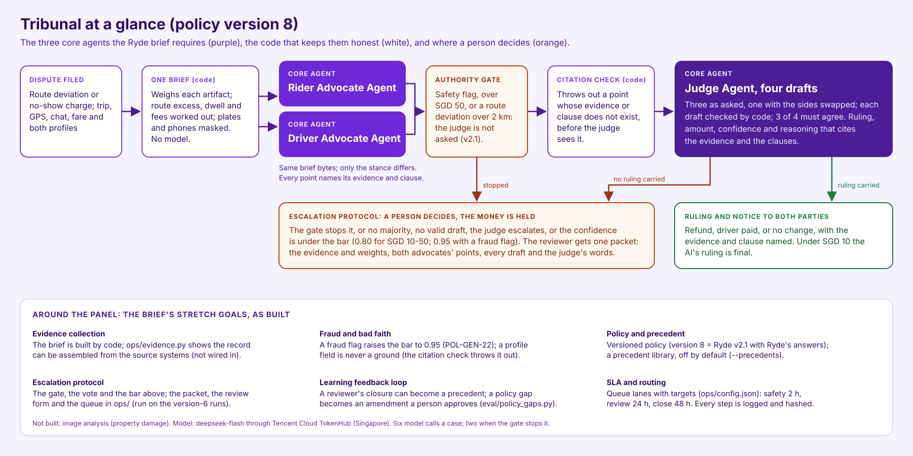

<p align="center">
  
</p>

<h1 align="center">Tribunal</h1>

<p align="center">
  <a href="https://tribunal.edgeone.dev/"></a>
  <a href="https://youtu.be/amkBjXyV1eg"></a>
  <a href="https://tribunal.edgeone.dev/try.html"></a>
  <a href="https://github.com/hanwei918/tribunal/actions/workflows/tests.yml"></a>
  
  
  <a href="LICENSE"></a>
</p>

<p align="center"><sub>Poster made with Miora (Tencent); the people in it are generated, not real people.</sub></p>

<p align="center"><sub>A hackathon prototype for the Ryde challenge of the 2026 Tencent Cloud AI Singapore Hackathon, not affiliated with or endorsed by Ryde. Every case except the organisers' samples 901, 902 and 903 is synthetic or semi-synthetic.</sub></p>

<p align="center"></p>

**Tribunal applies Ryde's own Dispute Resolution Policy v2.1, with Ryde's
answers of 2026-10-14** (policy version 8). It settles ride-hail disputes in
under three minutes at the median, and stops when it isn't sure.
Two AI lawyers argue the rider's and the driver's side from the same evidence pack.
Plain code throws out any point that does not cite real evidence and a real rule.
An AI judge rules four times, once with the two sides swapped, and three must agree.
When the judge is unsure or the rulings split, nobody guesses: the money is frozen
and a person decides.

Built for the 2026 Tencent Cloud AI Singapore Hackathon (Digital Native track, the
Ryde challenge) by team Newbee, with WorkBuddy.

**On Tencent Cloud.** Every model call goes to Tencent Cloud TokenHub:
`deepseek/deepseek-flash` in the Singapore region, set once in
`tribunal/model.py`. The site is static pages on Tencent EdgeOne Pages. Two
Tencent models were tried first and set aside: `hy3` failed the output contract
on early cases, and `hy4-preview` took 4.6 times the wall clock on the one case
the two could be compared on ([the decision](docs/notes/2026-09-23-runtime-model-decision.md)).

**Start here.**

- **Demo video (7:56):** <https://youtu.be/amkBjXyV1eg> — the problem, case 5051 from complaint to ruling, a story at the airport, and how it was built.
- **Live demo:** <https://tribunal.edgeone.dev/> — the organisers' two samples at version 8 at `/cases.html#ryde`, all 42 version-8 cases at `/v8-cases.html`, and case 5051 at `/v8-05051.html`.
- **Version 6 history:** the queue at `/queue.html`, case 208 at `/case-00208.html` and the organisers' sample case 901 at `/case-00901.html` are the version-6 pages.
- **Submission texts:** [`docs/submission/`](docs/submission/) · **Architecture:** [`docs/architecture.md`](docs/architecture.md)
- **How it was built:** [`docs/submission/how-we-built-it.md`](docs/submission/how-we-built-it.md)
- **What it does not do:** [Roadmap and known limits](#roadmap-and-known-limits), and [Limitations and disclosures](docs/record.md#limitations-and-disclosures)

**At a glance, policy version 8.** On `dev-v8`, 40 cases of development data
the team tuned against: a median of 153.1 s and 0.0390 USD a case, 28 of 40
decided with no person (70%), the swapped draft agreeing with the panel in 33
of 34 cases, and an expected calibration error of 0.097 (`python3 -m
eval.v8_report --report`). The sealed set `sealed-v4`, run once at version 7:
30/30, Wilson 95% [88.6%, 100.0%].

## The product site

The front page is the **product site** the policy owner, Ji Guofang, designed outside WorkBuddy: **twelve pages**, each in English (`*.html`) and Chinese (`*.zh.html`), with her images and a try-it page with a phone demo.
The site holds three layers of pages. The **version-8 case pages** are what Tribunal applies now: `v8-cases.html` indexes all 42 version-8 cases, and each of them has a page of its own in both languages, 86 files in all, built by `python3 -m ui.v8.build` from the committed runs.
The **version-6 pages** are history: the 151 version-6 case pages, each in English and Chinese in the site's own design (`case-<NNNNN>.html` and `case-<NNNNN>.zh.html`, 302 files, built by `python3 -m ui.v6.build`), each linking to the reviewer's page with every step of the decision, the escalation packet and the review form (`review-<NNNNN>.html`, in the site's own shell, the record in English), and the queue at `/queue.html`, both built by `python3 -m ui.v2.build` from the four version-6 runs.
The try-it page is her phone demo: it replays five committed version-8 runs (cases 5051, 5001 and 5013, and the organisers' samples 902 and 903), and runs a reader's changes through four version-8 rules in the browser -- the safety flag, the SGD 50 limit, the 2 km limit and the contact rule POL-NS-23 -- with no model call. Her script that generated `ui/site/static/try/phone.js` from the runs is not in this repository.
Her design, her page text and her front-end code are hers, imported unchanged and built here by `ui/site/build.py`; the try-it service `tryit/` is hers too. Her update of 2026-10-16 -- the business page, the phone demo, the Business link and the footer's disclaimer -- came in at part 111, with three sentences of the business page corrected to version 8.

## In numbers

**Version 8** — `dev-v8`, 40 cases of **development data** the team tuned
against, read off the committed run by `python3 -m eval.v8_report --report`. No
figure here is a generalisation figure.

| | Version 8 (`dev-v8`) | Today |
|---|---|---|
| Time to a decision | a median of **153.1 s** a case, and 299.4 s at the 90th percentile | 24–72 hours per dispute (the Ryde brief) |
| Model cost per case | a median model cost of **0.0390 USD** a case | — |
| Decided with no person needed | 28 of 40 ruled by the AI (70%) | every case |
| Sent to a person | 12 to a person -- 5 stopped by a v2.1 rule before the judge (2 on the 2 km limit, 1 on the value, 2 on a safety flag), 6 the panel sent on, 1 without a majority | — |

**Calibration, at version 8.** Expected calibration error 0.097 over 139 drafts,
at the version-8 bar of 0.80 (`python3 -m eval.v8_report --report`).

**At version 7** the sealed run's own median is **139.8 s** a case, with a median
model cost of **0.0398 USD** a case, over the 30 cases of `sealed-v4`
(`python3 -m eval.sealed_report --set sealed-v4`). A different set at a different
policy version: none of the rows is pooled with another.

**Version 6 (history).** Every figure in this table is from the version-6 runs,
at the team's own policy frozen on 2026-10-11. 151 disputes at policy version 6
(the corpus, `dev-v2-ext`, case 1779 and the organisers' case 901), read off the
committed runs by `python3 -m eval.business_value --report`. No figure below
needs a key to recompute.

| | Tribunal (version 6) | Today |
|---|---|---|
| Time to a decision | **160.4 s** median, 286.9 s at the 90th percentile | 24–72 hours per dispute (the Ryde brief) |
| Model cost per case | **0.0579 USD** median | — |
| Decided with no person needed | **112 of 151** (74.2%) | every case |
| Sent to a person | 26 with no ruling, 13 ruled but above SGD 8 so a person releases the money | — |

## What makes it different

Every row below is true of **version 8**, except where the row itself says
otherwise.

| | |
|---|---|
| **Two sides, one judge** | A rider's AI lawyer and a driver's AI lawyer read byte-identical evidence. Their instructions differ only in whose side they are on, and the code checks that before any call. |
| **No proof, no point** | Case 5051: 1 of 11 points thrown out by code before the judge saw them. A deterministic referee drops any claim that cites no evidence id or no clause id, or cites one that does not exist. It never picks a winner. |
| **Never one shot** | The judge drafts four rulings, one with the parties' positions swapped. The swapped draft agreed with the panel on all four fields in 33 of 34 cases at version 8 (`dev-v8`, development data). |
| **Money by code** | DISP-001's SGD 3.44 = 4.30 km x 0.80, worked out by code and handed to the person who decides. Distances, waiting time, fares, surge and promo lines are computed in `Decimal`, and a draft whose amount is not read off a figure the brief publishes is refused. |
| **Knows its limits** | v2.1's gates in code: a safety flag, a value over SGD 50 or a route deviation over 2 km goes to a person after the lawyers have prepared the file and before the judge is asked; a ruling stands only at the confidence v2.1 asks (0.80; 0.95 where a party carries a fraud flag, on Tribunal's reading C15 for a no-show); a split panel goes to a person. The appeal and the switch are the version-6 operations layer, and bringing them to version 8 is on the roadmap. |
| **Hard to fool** | Six attacks planted in party text (a forged system message, a fake clause, base64, zero-width characters): 5 rulings unchanged, 1 sent to a person, none flipped. **(version 6)** |
| **On the record** | Every call and check goes into a hash-chained event log. An offline test replays 128 recorded cases with no model call and checks each request against the recording. |
| **An operations layer** (version 6 runs) | A queue with service targets, an escalation packet for the reviewer, an evidence window, appeals, fraud signals, and a read-only WorkBuddy connector. |

<p align="center"></p>

## Quick start

Python 3.9 and 3.13 (both tested) and nothing else: `requirements.txt` declares no dependency.

```bash
git clone <this repository> && cd tribunal
python3 -m tools.verify                         # every check below, in one command
python3 -m eval.v8_report --report              # the version-8 figures above
python3 -m eval.development_sets --report       # every registered set's own result
python3 -m eval.sealed_report --set sealed-v4   # the version-7 sealed run
python3 -m ui.v8.build --check                  # the version-8 case pages
python3 -m ui.v6.build --check                  # the version-6 case pages, both languages
python3 -m unittest discover -s tests           # the full suite
```

None of these makes a model call or needs a key. Clone rather than download a zip:
29 tests read the git history and skip without it. On Linux, the tests that rebuild
case 111's brief also skip, because glibc and macOS libm differ in the last digit of
one distance ([why](docs/record.md#limitations-and-disclosures)).

To arbitrate a case for real at version 8 you need a Tencent Cloud TokenHub key:

```bash
export TOKENHUB_API_KEY=...
python3 -m eval.development_sets --set dev-v8 --cases 5051 --parallel-calls \
    --concurrency 2 --timeout 900 --prompts-dir prompts/v2 --runs-dir /tmp/tribunal-runs
```

Those are the set's own registered arguments: a version-8 set freezes its
concurrency, its timeout and the prompt directory it pairs with.

## Commands

| Command | What it does |
|---|---|
| `python3 -m eval.v8_report --report` | Version 8's measurements: the clock, the cost, the automatic share, the swap and the calibration |
| `python3 -m eval.development_sets --report` | Every registered set's own result, at the policy version it was written for |
| `python3 -m eval.sealed_report --set sealed-v4` | The version-7 sealed run's result against its own key |
| `python3 -m ui.v8.build --check` | The 42 version-8 case pages, held to a fresh build |
| `python3 -m ui.v6.build --check` | The 151 version-6 case pages in English and Chinese, held to a fresh build |
| `python3 -m tools.verify` | Every check this repository ships, in one command |
| `python3 -m eval.v6_runs --report` (version-6 runs) | Agreement, escalation precision and recall, cost and time for every version-6 run |
| `python3 -m eval.fairness --report` (version-6 runs) | Errors by side, position-swap agreement, calibration |
| `python3 -m ops.queue --run-dir runs/policy-v6/deepseek-deepseek-flash` (version-6 runs) | The queue: lane, reason, due time for every case |
| `python3 -m ops.escalation --run-dir <run> --case N --format md` (version-6 runs) | The packet a human reviewer is handed |
| `python3 -m ops.risk --case N` (version-6 runs) | The fraud and bad-faith signals for one case |
| `python3 -m tribunal.precedents list` (version-6 runs) | The precedent library |
| `python3 -m tryit.server --recorded-test` | The try-it service, answering from a recording (no key) |

## Results

Agreement with each set's own key, on sets written apart from the code and run once
on frozen code. They are never pooled. None came from outside the team, and what
each author had seen is part of the result.

### Version 8 -- v2.1 with Ryde's answers (2026-10-14)

| Set | Agreement | Wilson 95% | Who wrote it, and what was seen early |
|---|---|---|---|
| `ryde-v8` (2 cases) | 1 of 2 against Ryde's stated outcomes as amended by its answer | n/a | The organisers' two samples, keyed by Ryde's own stated outcomes as amended by Ryde's answer of 2026-10-14. 902 (DISP-001, route deviation 4.3 km) is `ESCALATE`, which version 8's 2 km gate produces before the judge is asked and which is what Ryde answered, and it is matched; 903 (DISP-002, no-show) is `DRIVER_COMPENSATION` 5.00 with the fee upheld, and it escalated on the 0.95 bar Tribunal reads v2.1 6.3 as setting on a no-show (C15), which Ryde's sample does not share: two drafts escalated, one upheld the fee and one was voided for citing a clause version 8 does not have; three must agree. Development data |
| `dev-v8` (40 cases) | 39/40 | n/a | The dev-v7 cases with the version-8 key. **Development data the team tuned against**, so it is not a generalisation figure. One case misses: 5017, where the key escalates on a notice that can be established neither way and the judge read it as not informed, which is not a version-8 change |

### Version 7 -- v2.1 before Ryde's answers (2026-10-13)

| Set | Agreement | Wilson 95% | Who wrote it, and what was seen early |
|---|---|---|---|
| `sealed-v4` (30 cases) | 30/30 | [88.6%, 100.0%] | Claude Opus 5.5 in a fresh claude.ai chat, from the owner's prompt, Ryde's v2.1, the version-7 policy files, the public contract, a format checker and the organisers' sample case. That model is also the team's development assistant and helped write the version-7 policy files, and no person reviewed its key, so 30/30 says the system applies those files as that author reads them: it is not an independent benchmark, and 30 cases is a small sample. Run once on 2026-10-14 |
| `ryde-v7` (2 cases) | 1 of 2 against Ryde's stated outcomes | n/a | The organisers' two samples converted for v2.1, keyed by Ryde's own stated outcome. 902 (DISP-001, route deviation) is `PARTIAL_REFUND` 3.44, matched; 903 (DISP-002, no-show) is `DRIVER_COMPENSATION` 5.00 with the fee upheld, and the panel split 2-2 and escalated on the 0.95 bar Tribunal reads v2.1 6.3 as setting on a no-show (C15), which Ryde's sample does not share. Development data |
| `dev-v7` (40 cases) | 40/40 | n/a | Claude Opus 5.5, on the same terms as `sealed-v4`. **Development data the team tuned against**: three attempts and two fixes sit between its first run and this one, so it is not a generalisation figure |

sealed-v4 was run once, at version 7. Version 8 changes its key on one case
(6009, 2.4 km), which version 8's 2 km gate escalates before the judge is asked;
the other 29 were not run at version 8
(docs/notes/2026-10-14-policy-v8.md).

### Version 6 -- the team's own policy (frozen 2026-10-11)

| Set | Agreement | Wilson 95% | Who wrote it, and what was seen early |
|---|---|---|---|
| `wild-v2` (20 cases) | 18/20 | [69.9%, 97.2%] | OpenAI Codex for the policy owner; nobody on the development side opened it |
| `sealed-v1` (24 cases) | 21/24 (20/24 under the key as imported) | [69.0%, 95.7%] | Claude; the policy owner's AI assistant opened the cases and key before the freeze, and case 311's key changed before the run |
| `sealed-v2` (12 cases) | 12/12 | [75.8%, 100.0%] | The policy owner with OpenAI Codex, after seeing development results. Reviewed case by case after the run (2026-10-13) and adopted by the policy owner as her sign-off; the review was made with her AI assistant (Claude), which knew the 12/12 result. All 12 answers were found consistent with the version-6 policy, and none was changed. The pre-run sign-off the manifest asked for was not made |

Development data, reported as such: `dev-v2-ext` 115/120 and the 29-case corpus
26/29 at version 6. The full tables, every figure's recompute command, and each
set's provenance are in [the full record](docs/record.md#results).

The organisers' sample 901 at version 6: `DRIVER_COMPENSATION` SGD 4.00 at a
confidence of 0.9, unanimous, which upholds the charge as the organisers
expected (docs/record.md, Results).

## Roadmap and known limits

One line each, plainly. None of them is a surprise, and each names the file or
run that shows it.

- **Fare and surge disputes are not covered.** v2.1 Section 3 and `DISP-003` name
  them, and this prototype's own `POL-GEN-24` leaves them out -- that is the
  prototype's scope and not v2.1's ([the record](docs/record.md#version-8-at-a-glance)).
- **Property damage and image analysis are not covered.** v2.1 Section 4 needs
  images the pipeline does not read ([the record](docs/record.md#limitations-and-disclosures)).
- **C15 is Tribunal's own reading.** Tribunal reads v2.1 6.3 as setting a 0.95
  bar on a no-show, where v2.1 6.2 makes a no-show ruling AI-final and Ryde's own
  sample upholds the fee. Ryde's position, relayed by the organisers on
  2026-10-15: teams need not follow v2.1 strictly and may use their own policy for
  testing. Tribunal keeps C15 and states it
  ([the version-8 runs](docs/notes/2026-10-14-version-8-runs.md)).
- **Version 8 has no appeal clause**, and the operations layer -- appeal, queue,
  review, risk and the escalation packet -- was written for version 6 (`ops/`):
  the queue and the packet read a version-8 run too, but the queue's reasons
  name version-6 clauses.
- **The try-it phone replays recorded runs**: five version-8 cases, with four
  version-8 rules applied in the browser to a reader's changes; its generator is
  not in this repository.
- **The 151 version-6 case pages are history**: the team's own policy frozen on
  2026-10-11, not what Tribunal applies now
  (`ui/dist/case-*.html`, in English and Chinese; the parties' words and the
  agents' reasoning stay in English).
- **The v2.1 precedents (7.1-7.3) are not in the precedent library**, and the
  judge is not shown them by default (`precedents/precedents.jsonl`).
- **Confidence is the judge's own figure capped by the evidence weights**, not
  v2.1 6.3's four components (`prompts/v2/judge.system.md`, `tribunal/pipeline.py`).
- **The sealed figure is at version 7**, and its author is the team's own
  development assistant (`docs/notes/2026-10-14-version-7-runs.md`).
- **One model family.** Every committed run was made with the one runtime model in
  `tribunal/model.py`.
- **Synthetic data**, except the organisers' samples 901, 902 and 903.

## Documentation

| Document | What's covered |
|---|---|
| [The full record](docs/record.md) | Every result table and its command, test-set provenance, limitations, concurrency, how to run everything |
| [Why a debate](docs/why-debate.md) | The five mechanisms, and the paper the design comes from |
| [Design choices](docs/design-choices.md) | The two places the build departs from the brief, and what each buys and costs |
| [Scale and cost](docs/scale.md) | What one model account can carry, and what a month would cost |
| [Integration](docs/integration.md) | The input contract, the ruling's fields, routing, the queue, the packet, appeals |
| [Data](docs/data.md) | Who wrote each set, the one organisers' case, and how real data may differ |
| [Architecture](docs/architecture.md) | The four C4 views, box by box, with the file behind each box |
| [Submission texts](docs/submission/) | Blurb, description, judges' questions, how we built it |
| [Demo script](docs/submission/demo-script.md) | A three-minute live demo, step by step |
| [Governance](docs/governance/) | Threat model, privacy, incidents |
| [Policy sources](docs/policy-sources.md) | Where each policy clause comes from |
| [Dated notes](docs/notes/) | One note per change or run, written when it happened |
| [Version-8 policy](docs/notes/2026-10-14-policy-v8.md) | What Ryde's answers of 2026-10-14 change, and what version 8 is |
| [Version-8 runs](docs/notes/2026-10-14-version-8-runs.md) | The two version-8 sets' single runs, case by case |
| [Version-8 measurements](docs/notes/2026-10-14-version-8-measurements.md) | The version-8 clock, cost, swap, calibration and escalation figures |
| [WorkBuddy log](docs/buddy-log/README.md) | One row per WorkBuddy session, with screenshots |
| [WorkBuddy connector](integrations/workbuddy/) | A read-only MCP server over the committed records |
| [Try-it service](tryit/README.md) | A live-run service for one scenario, its limits and how to run it; the published site does not call it |
| [Changelog](CHANGELOG.md) | Every change since `freeze-2026-10-11`, the three freezes (versions 6, 7 and 8) and the command that shows each frozen tree |

## Team and licence

Team Newbee: Zhou Hanwei, Ji Guofang, Yan Lin. Built with WorkBuddy; the
[buddy log](docs/buddy-log/README.md) records every session.

MIT — see [LICENSE](LICENSE). Case 901 is the organisers' sample and remains their
material; third-party material is listed in [the full record](docs/record.md#third-party-material).
