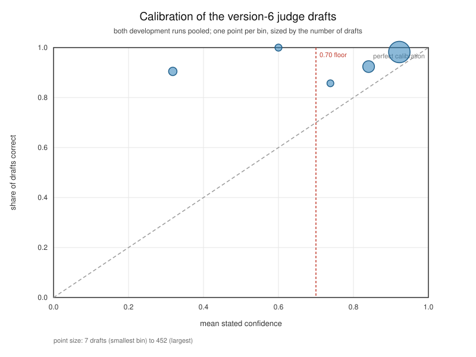

# Tribunal

2026 Tencent Cloud AI Singapore Hackathon / Digital Native / Ryde / Newbee.

**An automatic ruling is a first decision, not the last word: a party may appeal it once within 30 days under `POL-GEN-04`; an amount above the execution threshold of `POL-GEN-05`, and every dispute carrying a safety or complaint flag under `POL-GEN-08(1)`, go to a human reviewer under `POL-GEN-06`; and the kill switch `auto_rulings_enabled` in `ops/config.json` lets a human switch automatic rulings off.**

Execution start: 2026-09-18. Feature freeze tagged 2026-10-09 (`freeze-2026-10-09`). Submission: 2026-10-16 (the exact time is per the submission platform).

The same system is written out box by box, one paragraph per box and the file that implements it, in [`docs/architecture.md`](docs/architecture.md).

## The live demo

The product view is live at <https://tribunal.edgeone.dev/>: today's 151
disputes, one line each, with the ones decided automatically and the ones sent to
a human. The evaluation replay is one level down at
<https://tribunal.edgeone.dev/replay/>, and its runs index — one line per set —
is at <https://tribunal.edgeone.dev/replay/runs/>.

Both sites are static replays of the runs committed in this repository: every
page is built from a run's own recorded files, so neither makes a **model call**
and neither needs a key. They are hosted on Tencent EdgeOne Pages, and the same
pages are committed at `ui/dist/`, where they open straight from `file://`.

**The root is the product view**, built by `python3 -m ui.v2.build` from the four
committed version-6 runs. It is the page a support team would work from rather
than a page about the benchmark: four featured cases, the queue's figures, and,
for each case, the ruling, the key figures set against the policy limits they are
tested against, both advocates' claims with the referee's verdict on each, a
trace drawn from the GPS fixes, the evidence with the weight the admissibility
precheck gave it, the six steps of how it was decided — expandable down to the
agents' own words — and, for a case that went to a reviewer, the escalation
packet with its digest and a form that builds the closing command.

**The evaluation replay is under `replay/`**, built by `python3 -m ui.build`. It
is the benchmark page: the 29 corpus cases at policy version 1 with an answer key
beside them and a miss marked where the ruling and the key disagree, and, beside
it, the held-out set, the second sealed set and the organisers' sample case.
Every page there carries a link back to the queue.

Both are one self-contained file per page with no request of any kind, so they
open from `file://` exactly as they do when served. The product view is published
at the root and the replay under `replay/` after the owner approves.

## What Tribunal is

Tribunal arbitrates a ride-hail dispute and writes down why. One brief is built
from the public case content and the loaded policy, and **two advocates argue from
that same brief under opposite stances** — the rider's and the driver's — so both
sides read byte-identical evidence and differ only in their instructions. A
**deterministic referee** then reads both claim sets and discards any claim that
cites no evidence id or no clause id, any citation that does not resolve, any
claim resting on impaired evidence without disclosing the impairment, and any
claim that uses a context-only profile field as a ground; it never decides the
merits. An **admissibility precheck** weights every artifact by the issue codes
the corpus attaches to it, so impaired evidence is carried into the case rather
than silently trusted. A **judge rules four times** on the same inputs and the
majority decides. Below the **confidence floor of 0.70**, or on a policy
escalation, the case gets no ruling at all: it goes to a **human reviewer with the
fee held** rather than collected or refunded.

At policy version 6 the system adds three things. A **scope gate** under
`POL-GEN-08(1)` routes a safety- or complaint-flagged dispute to a human with no
model call at all, before any prompt is rendered. The platform's own **arrival
and wait-timer events** are admitted under `POL-NS-12` as a carrier independent
of the exported GPS trace, so a sparse or accuracy-less export does not defeat a
platform-confirmed arrival and a served waiting period. The policy owner
confirmed the clause's revised wording on 2026-10-10
([`docs/notes/2026-10-10-ns-12-confirmed-by-policy-owner.md`](docs/notes/2026-10-10-ns-12-confirmed-by-policy-owner.md)).
And `POL-GEN-08(4)`'s
**masking of vehicle registration marks, telephone numbers and e-mail
addresses** is applied to the brief, so none of them reaches an advocate, a
judge or a reviewer.

## Results

**The frozen system, at policy version 6**

These are the submission's figures, measured at policy version 6. The owner made
the five runs once, outside this workspace, from a clean checkout of the commit
tagged `freeze-2026-10-09`, and they are committed under `runs/policy-v6/`,
`runs/precedents/policy-v6/`, `runs/dev-v2-ext/policy-v6/`,
`runs/dev-v2/policy-v6/` and `runs/ryde-v3/policy-v6/`. Every row is printed by
`python3 -m eval.v6_runs --report` and recomputed by
`tests/test_readme_figures.py` from the committed runs and keys; the note that
reads them is `docs/notes/2026-10-10-the-version-6-development-runs.md`.

| figure | value | read from | recompute with | model call |
|---|---|---|---|---|
| `dev-v2-ext` — four-field exact | 115/120 = 95.8% | `runs/dev-v2-ext/policy-v6/deepseek-deepseek-flash/`, `eval/answers/dev-v2-ext/ground_truth.json` | `python3 -m eval.v6_runs --report` | no |
| `dev-v2-ext` — Wilson 95% interval | [90.6%, 98.2%] | `runs/dev-v2-ext/policy-v6/deepseek-deepseek-flash/`, `eval/answers/dev-v2-ext/ground_truth.json` | `python3 -m eval.v6_runs --report` | no |
| `dev-v2-ext` — escalation precision | 16/20 = 0.8 | `runs/dev-v2-ext/policy-v6/deepseek-deepseek-flash/`, `eval/answers/dev-v2-ext/ground_truth.json` | `python3 -m eval.v6_runs --report` | no |
| `dev-v2-ext` — escalation recall | 16/17 = 0.941 | `runs/dev-v2-ext/policy-v6/deepseek-deepseek-flash/`, `eval/answers/dev-v2-ext/ground_truth.json` | `python3 -m eval.v6_runs --report` | no |
| `dev-v2-ext` — over-escalations | 2749, 2809, 2829, 2853 | `runs/dev-v2-ext/policy-v6/deepseek-deepseek-flash/`, `eval/answers/dev-v2-ext/ground_truth.json` | `python3 -m eval.v6_runs --report` | no |
| `dev-v2-ext` — under-escalation | 2858 | `runs/dev-v2-ext/policy-v6/deepseek-deepseek-flash/`, `eval/answers/dev-v2-ext/ground_truth.json` | `python3 -m eval.v6_runs --report` | no |
| `dev-v2-ext` — calibration and holdout splits, four-field exact | calibration 75/79 = 94.9%; holdout 40/41 = 97.6% | `runs/dev-v2-ext/policy-v6/deepseek-deepseek-flash/`, `eval/answers/dev-v2-ext/ground_truth.json`, `data/external/dev-v2-ext/split.json` | `python3 -m eval.v6_runs --report` | no |
| Corpus at version 6 — four-field exact | 26/29 = 89.7% | `runs/policy-v6/deepseek-deepseek-flash/`, `eval/answers/ground_truth.json` | `python3 -m eval.v6_runs --report` | no |
| Corpus at version 6 — cases that differ from the key | 107, 112, 211 | `runs/policy-v6/deepseek-deepseek-flash/`, `eval/answers/ground_truth.json` | `python3 -m eval.v6_runs --report` | no |
| Precedent arm — the 15 route-deviation cases, with precedents | 15/15 = 100.0% | `runs/precedents/policy-v6/deepseek-deepseek-flash/`, `eval/answers/ground_truth.json` | `python3 -m eval.v6_runs --report` | no |
| Precedent arm — the same 15, without precedents | 13/15 = 86.7% | `runs/policy-v6/deepseek-deepseek-flash/`, `eval/answers/ground_truth.json` | `python3 -m eval.v6_runs --report` | no |
| Precedent arm — rulings that changed | 107, 112 | `runs/precedents/policy-v6/deepseek-deepseek-flash/`, `runs/policy-v6/deepseek-deepseek-flash/` | `python3 -m eval.v6_runs --report` | no |
| Sample case 901 at version 6 | DRIVER_COMPENSATION 4.00, confidence 0.9, unanimous | `runs/ryde-v3/policy-v6/deepseek-deepseek-flash/` | `python3 -m eval.v6_runs --report` | no |
| `dev-v2` case 1779 (prompt injection in the chat) at version 6 | ESCALATE | `runs/dev-v2/policy-v6/deepseek-deepseek-flash/`, `eval/answers/dev-v2/ground_truth.json` | `python3 -m eval.v6_runs --report` | no |
| Cost of the version-6 runs, from the transcripts | corpus 2.3053 USD; dev-v2-ext 7.9197 USD; dev-v2 0.0377 USD; ryde-v3 0.0638 USD; precedents 0.9289 USD | the five run directories' `case-*.json` (`tokens`) | `python3 -m eval.v6_runs --report` | no |
| Fairness, both version-6 runs — errors towards the rider / towards the driver / to an escalation | 0 / 1 / 5 | `runs/policy-v6/deepseek-deepseek-flash/`, `runs/dev-v2-ext/policy-v6/deepseek-deepseek-flash/`, `eval/answers/ground_truth.json`, `eval/answers/dev-v2-ext/ground_truth.json` | `python3 -m eval.fairness --report` | no |
| Fairness, both version-6 runs — position-swap agreement on all four graded fields | 136/141 = 96.5% | `runs/policy-v6/deepseek-deepseek-flash/`, `runs/dev-v2-ext/policy-v6/deepseek-deepseek-flash/` | `python3 -m eval.fairness --report` | no |
| Fairness, both version-6 runs — expected calibration error | 0.088 | `runs/policy-v6/deepseek-deepseek-flash/`, `runs/dev-v2-ext/policy-v6/deepseek-deepseek-flash/` | `python3 -m eval.fairness --report` | no |

**What these sets are.** `dev-v2-ext` is development data, drafted by the key
owner for policy version 3; it is not a sealed set and it is not a generalisation
figure. Its holdout cases 2734, 2758 and 2832 are the cases the key owner's
amendments were drafted from, so the holdout split is not clean. Its five cases
that differ from the key — 2749, 2809, 2829, 2853 and 2858 — are explained one by
one in
[`docs/notes/2026-10-10-what-went-wrong-at-version-6.md`](docs/notes/2026-10-10-what-went-wrong-at-version-6.md).

**The corpus key.** The corpus key at `eval/answers/ground_truth.json` was written
under policy version 1, and the corpus was measured at version 6. The three cases
that differ from it — 107, 112 and 211 — are listed above and are explained one by
one in
[`docs/notes/2026-10-10-what-went-wrong-at-version-6.md`](docs/notes/2026-10-10-what-went-wrong-at-version-6.md):
107 is a split, its panel two drafts for a `PARTIAL_REFUND 7.45` and two for an
`ESCALATE`, so no majority of three carried and the case escalated; 112 is a
missed `POL-RD-10(4)` trigger, the trace's first fix 13 minutes 30 seconds before
the trip record's `started_at` against the clause's 10-minute limb, which the
judge read past and ruled `NO_ACTION`; and 211 is a contested reading of
`POL-GEN-02(2)`, the majority bridging the trace's 168-second recording gap with
the chat log and paying the driver 3.20 where the key splits the fee and refunds
2.00. The key owner ruled on 2026-10-10 that the key's reading stands, so 211
remains a miss
([`docs/notes/2026-10-10-case-211-owner-ruling.md`](docs/notes/2026-10-10-case-211-owner-ruling.md)).

**The precedent arm.** With the switch on the 15 route-deviation cases score
15/15, and without it they score 13/15; the two cases whose ruling changed are 107
and 112. Neither 107's nor 112's ruling with precedents mentions a precedent, and
`precedents/precedents.jsonl` holds two precedents, so the difference is not
attributed to the precedents. It is reported, not claimed.

**The third sealed set (`sealed-v1`), at policy version 6**

`sealed-v1` is 24 cases, imported and registered at policy version 6. Its single
run was made once by the owner, on 2026-10-10, from the commit `feb7174`, whose
`tribunal/`, `prompts/` and `policy/` trees equal those at the freeze tagged
`freeze-2026-10-09`, and it is committed at `runs/sealed-v1/deepseek-deepseek-flash/`.
The set's own protocol asks for the **agreement** against its key rather than an
"accuracy", so that is the word used here, and its figure is the submission's
third generalisation figure: it is **never** pooled with `wild-v1`'s or
`wild-v2`'s. The key owner re-derived the key under version 6 on 2026-10-10
without seeing any output on the set; the old and new `answer_key_sha256` are
`7529d925…` (imported) and `f430f6c0…` (at the run). The note that reads the run
is `docs/notes/2026-10-10-the-third-sealed-run.md`.

| figure | value | read from | recompute with | model call |
|---|---|---|---|---|
| Third sealed set (`sealed-v1`) — four-field agreement, of the cases that produced a ruling | 21/24 = 87.5% | `runs/sealed-v1/deepseek-deepseek-flash/case-*.json`, `eval/answers/sealed-v1/ground_truth.json` | `python3 -m eval.sealed_report --set sealed-v1` | no |
| Third sealed set (`sealed-v1`) — four-field agreement, over all 24 cases | 21/24 = 87.5% | `runs/sealed-v1/deepseek-deepseek-flash/`, `eval/answers/sealed-v1/ground_truth.json` | `python3 -m unittest tests.test_readme_figures -v` | no |
| Third sealed set (`sealed-v1`) — ruling alone, of the cases that produced a ruling | 21/24 = 87.5% | `runs/sealed-v1/deepseek-deepseek-flash/case-*.json`, `eval/answers/sealed-v1/ground_truth.json` | `python3 -m eval.sealed_report --set sealed-v1` | no |
| Third sealed set (`sealed-v1`) — Wilson 95% interval | [69.0%, 95.7%] | `runs/sealed-v1/deepseek-deepseek-flash/`, `eval/answers/sealed-v1/ground_truth.json` | `python3 -m unittest tests.test_readme_figures -v` | no |
| Third sealed set (`sealed-v1`) — escalation precision | 3/5 = 0.6 | `runs/sealed-v1/deepseek-deepseek-flash/case-*.json`, `eval/answers/sealed-v1/ground_truth.json` | `python3 -m unittest tests.test_readme_figures -v` | no |
| Third sealed set (`sealed-v1`) — escalation recall | 3/4 = 0.75 | `runs/sealed-v1/deepseek-deepseek-flash/case-*.json`, `eval/answers/sealed-v1/ground_truth.json` | `python3 -m unittest tests.test_readme_figures -v` | no |
| Third sealed set (`sealed-v1`) — over-escalations | 304, 312 | `runs/sealed-v1/deepseek-deepseek-flash/case-*.json`, `eval/answers/sealed-v1/ground_truth.json` | `python3 -m unittest tests.test_readme_figures -v` | no |
| Third sealed set (`sealed-v1`) — under-escalation | 410 | `runs/sealed-v1/deepseek-deepseek-flash/case-*.json`, `eval/answers/sealed-v1/ground_truth.json` | `python3 -m unittest tests.test_readme_figures -v` | no |
| Third sealed set (`sealed-v1`) — ROUTE_DEVIATION four-field agreement | 10/12 = 83.3% | `runs/sealed-v1/deepseek-deepseek-flash/`, `eval/answers/sealed-v1/ground_truth.json`, `data/external/sealed-v1/index.json` | `python3 -m eval.sealed_report --set sealed-v1` | no |
| Third sealed set (`sealed-v1`) — NO_SHOW_CHARGE four-field agreement | 11/12 = 91.7% | `runs/sealed-v1/deepseek-deepseek-flash/`, `eval/answers/sealed-v1/ground_truth.json`, `data/external/sealed-v1/index.json` | `python3 -m eval.sealed_report --set sealed-v1` | no |
| Third sealed set (`sealed-v1`) — cases with no ruling | none | `runs/sealed-v1/deepseek-deepseek-flash/run.json` | `python3 -m unittest tests.test_readme_figures -v` | no |

**The earlier blocks.** Every block below was measured at policy version 1 or 2,
from the earlier freezes; they are kept as they were.

Read the table below from the top. The first block is the submission's claim;
every block below it is context that says what that claim is worth.

Three figures are **generalisation** figures, and each is its own. The held-out
set (`wild-v1`) is 64 cases whose author says its traps come from real
complaints, prepared by their author as a development set; nobody who changed the
system opened them before the freeze tagged `freeze-2026-09-30`, and they were
run once from that tag. The second
sealed set (`wild-v2`) is 20 cases, run once on 2026-10-04 from a commit whose
`tribunal/`, `prompts/` and `policy/` trees equal those at the freeze tagged
`freeze-2026-10-03`. The third sealed set (`sealed-v1`) is 24 cases, run once on
2026-10-10 from the commit `feb7174`, whose `tribunal/`, `prompts/` and `policy/`
trees equal those at the freeze tagged `freeze-2026-10-09`. The corpus and the
second set are **development** data the system was built against, so a figure
over them measures fit, not generalisation. **The three sealed figures are never
summed or pooled** — one figure over 64 cases, one over 20 and one over 24 are
not a measurement of 108 cases — and no sealed set is ever produced by
`--set all`. The second sealed set's run, its figures and its two misses are read
in `docs/notes/2026-10-04-the-second-sealed-run.md`, and the third's in
`docs/notes/2026-10-10-the-third-sealed-run.md`.

**Where the corpus came from.** The 29-case corpus was written by this team before
the kick-off, following the dispute types in the organisers' brief. It is **not**
organiser data. The only organiser-supplied case is `DISP-002`, converted as case
901 and credited under [Third-party material](#third-party-material).

| figure | value | read from | recompute with | model call |
|---|---|---|---|---|
| Held-out set (`wild-v1`) — four-field exact, of the cases that produced a ruling | 55/62 = 88.7% | `runs/wild/deepseek-deepseek-flash/case-*.json`, `eval/answers/wild/ground_truth.json` | `python3 -m eval.development_sets --report` | no |
| Held-out set (`wild-v1`) — four-field exact, over all 64 cases | 55/64 = 85.9% | `runs/wild/deepseek-deepseek-flash/`, `eval/answers/wild/ground_truth.json` | `python3 -m unittest tests.test_readme_figures -v` | no |
| Held-out set (`wild-v1`) — ruling alone, of the cases that produced a ruling | 56/62 = 90.3% | `runs/wild/deepseek-deepseek-flash/case-*.json`, `eval/answers/wild/ground_truth.json` | `python3 -m eval.development_sets --report` | no |
| Held-out set (`wild-v1`) — escalation precision | 3/7 = 0.429 | `runs/wild/deepseek-deepseek-flash/case-*.json`, `eval/answers/wild/ground_truth.json` | `python3 -m unittest tests.test_readme_figures -v` | no |
| Held-out set (`wild-v1`) — escalation recall | 3/4 = 0.75 | `runs/wild/deepseek-deepseek-flash/case-*.json`, `eval/answers/wild/ground_truth.json` | `python3 -m unittest tests.test_readme_figures -v` | no |
| Held-out set (`wild-v1`) — over-escalations | 501, 504, 508, 530 | `runs/wild/deepseek-deepseek-flash/case-*.json`, `eval/answers/wild/ground_truth.json` | `python3 -m unittest tests.test_readme_figures -v` | no |
| Held-out set (`wild-v1`) — under-escalation | 627 | `runs/wild/deepseek-deepseek-flash/case-*.json`, `eval/answers/wild/ground_truth.json` | `python3 -m unittest tests.test_readme_figures -v` | no |
| Held-out set (`wild-v1`) — cases with no ruling | 517, 533 | `runs/wild/deepseek-deepseek-flash/run.json` | `python3 -m unittest tests.test_readme_figures -v` | no |
| Held-out set (`wild-v1`) — cases that differ from the key | 501, 504, 508, 523, 530, 622, 627 | `runs/wild/deepseek-deepseek-flash/case-*.json`, `eval/answers/wild/ground_truth.json` | `python3 -m unittest tests.test_readme_figures -v` | no |
| Second sealed set (`wild-v2`) — four-field exact, of the cases that produced a ruling | 18/20 = 90.0% | `runs/wild-v2/deepseek-deepseek-flash/case-*.json`, `eval/answers/wild-v2/ground_truth.json` | `python3 -m eval.sealed_report --set wild-v2` | no |
| Second sealed set (`wild-v2`) — four-field exact, over all 20 cases | 18/20 = 90.0% | `runs/wild-v2/deepseek-deepseek-flash/`, `eval/answers/wild-v2/ground_truth.json` | `python3 -m unittest tests.test_readme_figures -v` | no |
| Second sealed set (`wild-v2`) — ruling alone, of the cases that produced a ruling | 18/20 = 90.0% | `runs/wild-v2/deepseek-deepseek-flash/case-*.json`, `eval/answers/wild-v2/ground_truth.json` | `python3 -m eval.sealed_report --set wild-v2` | no |
| Second sealed set (`wild-v2`) — escalation precision | 4/5 = 0.8 | `runs/wild-v2/deepseek-deepseek-flash/case-*.json`, `eval/answers/wild-v2/ground_truth.json` | `python3 -m unittest tests.test_readme_figures -v` | no |
| Second sealed set (`wild-v2`) — escalation recall | 4/5 = 0.8 | `runs/wild-v2/deepseek-deepseek-flash/case-*.json`, `eval/answers/wild-v2/ground_truth.json` | `python3 -m unittest tests.test_readme_figures -v` | no |
| Second sealed set (`wild-v2`) — over-escalation | 702 | `runs/wild-v2/deepseek-deepseek-flash/case-*.json`, `eval/answers/wild-v2/ground_truth.json` | `python3 -m unittest tests.test_readme_figures -v` | no |
| Second sealed set (`wild-v2`) — under-escalation | 716 | `runs/wild-v2/deepseek-deepseek-flash/case-*.json`, `eval/answers/wild-v2/ground_truth.json` | `python3 -m unittest tests.test_readme_figures -v` | no |
| Second sealed set (`wild-v2`) — ROUTE_DEVIATION four-field exact | 10/12 = 83.3% | `runs/wild-v2/deepseek-deepseek-flash/`, `eval/answers/wild-v2/ground_truth.json`, `data/external/wild-v2/index.json` | `python3 -m eval.sealed_report --set wild-v2` | no |
| Second sealed set (`wild-v2`) — NO_SHOW_CHARGE four-field exact | 8/8 = 100.0% | `runs/wild-v2/deepseek-deepseek-flash/`, `eval/answers/wild-v2/ground_truth.json`, `data/external/wild-v2/index.json` | `python3 -m eval.sealed_report --set wild-v2` | no |
| Second sealed set (`wild-v2`) — cases with no ruling | none | `runs/wild-v2/deepseek-deepseek-flash/run.json` | `python3 -m unittest tests.test_readme_figures -v` | no |
| Corpus — four-field exact (development) | 29/29 = 100.0% | `runs/deepseek-deepseek-flash/`, `eval/answers/ground_truth.json` | `python3 -m eval.development_sets --report` | no |
| Second set — four-field exact (development) | 14/15 = 93.3% | `runs/codex/deepseek-deepseek-flash/`, `eval/answers/codex/ground_truth.json` | `python3 -m eval.development_sets --report` | no |
| Ablation — admissibility precheck removed, both sets | 40/44 = 90.9% | `runs/ablation/admissibility/`, `runs/codex/ablation/admissibility/` | `python3 -m unittest tests.test_readme_figures -v` | no |
| Ablation — admissibility removed, case 112 | DRIVER_COMPENSATION 1.80, unanimous | `runs/ablation/admissibility/deepseek-deepseek-flash/case-00112.json` | `python3 -m unittest tests.test_readme_figures -v` | no |
| Ablation — clause notes removed, both sets | 41/44 = 93.2% | `runs/ablation/clause-notes/`, `runs/codex/ablation/clause-notes/` | `python3 -m unittest tests.test_readme_figures -v` | no |
| Baseline — always ESCALATE, both sets | 7/44 = 15.9% | `runs/baselines/report.md`, `runs/baselines/baselines.json` | `python3 -m eval.baselines --set all` | no |
| Baseline — one draft, mean of the four, both sets | 42.25/44 = 96.0% | `runs/baselines/report.md`, `runs/baselines/baselines.json` | `python3 -m eval.baselines --set all` | no |
| Baseline — the carried vote, both sets | 43/44 = 97.7% | `runs/baselines/report.md`, `runs/baselines/baselines.json` | `python3 -m eval.baselines --set all` | no |
| Verifier — rulings the material rule changed | 0 of 42 | `runs/verify-recorded-drafts/deepseek-deepseek-flash/verify-recorded.json`, `runs/codex/verify-recorded-drafts/deepseek-deepseek-flash/verify-recorded.json` | `python3 -m unittest tests.test_readme_figures -v` | no |
| Verifier — statements judged contradicted | 57 of 3,179 (15 material) | `runs/verify-recorded-drafts/*/deepseek-deepseek-flash/verify-recorded.json` | `python3 -m unittest tests.test_readme_figures -v` | no |
| Verifier — cases carrying a material contradiction | 102, 107, 108, 110, 9102, 9104, 9113 | `runs/verify-recorded-drafts/*/deepseek-deepseek-flash/verify-recorded.json` | `python3 -m unittest tests.test_readme_figures -v` | no |
| Verifier — the switch in every scored run | off, in all 8 | every scored run's `case-*.json`, each of which records its own `configuration`; the two development runs record none, in `run.json` or in their case files, and they predate the verifier (`a62ad0d`), so it could not have been on for them | `python3 -m unittest tests.test_readme_figures -v` | no |
| Sample case 901 — under the current pipeline | ESCALATE, confidence 0.6 | `runs/rerun-2026-09-29/external/ryde/case-00901.json` | `python3 -m unittest tests.test_readme_figures -v` | no |
| Sample case 901 — the organisers' stated expectation | Cancellation charge UPHELD | `eval/external/ryde/expected.json` | `python3 -m unittest tests.test_readme_figures -v` | no |

**Each sealed block is read from its own single run and its own freeze.** The
`wild-v1` rows are read from the run of 2026-09-30, made from the commit tagged
`freeze-2026-09-30`; the `wild-v2` rows are read from the run of 2026-10-04, made
from a commit whose `tribunal/`, `prompts/` and `policy/` trees equal those at
`freeze-2026-10-03`; the `sealed-v1` rows are read from the run of 2026-10-10,
made from the commit `feb7174`, whose `tribunal/`, `prompts/` and `policy/`
trees equal those at `freeze-2026-10-09`. No sealed figure is added to another
sealed figure or to any development figure.

**Which policy version each block was measured at.** The corpus, the second
development set and `wild-v1` were all measured at **policy version 1**, the
three files in `policy/` exactly as they stood before amendment `0001`; the
`wild-v2` block is the one measured at **version 2**. The version-2 re-run of the
57 affected development cases is committed at `39a8a36` under `runs/policy-v2/`,
`runs/codex/policy-v2/` and `runs/wild-dev/policy-v2/`, with `rerun.json`,
`diff.json` and `diff.md`.

**About the second sealed set's provenance.** The set shares three of its eight
generator files with `wild-v1` — `core.py`, `places.py` and `wild.py` — and
`wild-v1` became development data on 2026-10-01, so 18/20 is read as an **upper
estimate** rather than as an expectation. Whether the set's author, OpenAI Codex,
could read this repository while preparing it is **not recorded**. One interrupted
attempt on 2026-10-03 at 14:14 partly called cases 701 and 702; its record was
deleted, and the owner ruled before the run that the attempt does not count under
the protocol. The run's own note is
`docs/notes/2026-10-04-the-second-sealed-run.md`.

**Every command above is read-only and makes no model call.** The three module
commands are `python3 -m eval.development_sets --report`, which prints each set's
row (cases, four-field exact, and the four fields separately) and its currency;
`python3 -m eval.baselines --set all`, which prints the baseline table; and
`python3 -m eval.sealed_report --set <set>`, which prints one sealed set's own
figures on both bases, per category, and its escalation counts. The
rest are recomputed by `tests/test_readme_figures.py`, which parses these tables
and recomputes every row from the committed files and the frozen keys:

    python3 -m unittest tests.test_readme_figures -v

Every figure is its own subtest, so a failure names the figure, the value this
file states and the value the committed files hold. The module also fails if a
figure is dropped from the table or added to it without being checked, and if any
row's `model call` cell is not `no`.

**The runs themselves did make model calls, and none of them was made here — with
one exception that does not count.** Each run in the table below was made once by
the owner outside this sandbox and committed byte for byte as produced. The one
exception is the interrupted attempt on 2026-10-03 at 14:14, which partly called
cases 701 and 702 before it was stopped; its record was deleted, it is not a run
in the table, and the owner ruled before the run that it does not count under the
protocol. The commands that made them, and which of them were paid for, are:

| run | command | when |
|---|---|---|
| held-out set (`wild-v1`) | `python3 -m eval.development_sets --set wild --concurrency 2 --timeout 900` | once, 2026-09-30, from the commit tagged `freeze-2026-09-30` |
| second sealed set (`wild-v2`) | `TRIBUNAL_SEALED_RUN=wild-v2 python3 -m eval.development_sets --set wild-v2 --concurrency 2 --timeout 900` | once, 2026-10-04, from a commit whose `tribunal/`, `prompts/` and `policy/` trees equal those at `freeze-2026-10-03` |
| third sealed set (`sealed-v1`) | `TRIBUNAL_SEALED_RUN=sealed-v1 python3 -m eval.development_sets --set sealed-v1 --parallel-calls --concurrency 2 --timeout 900` | once, 2026-10-10, from the commit `feb7174`, whose `tribunal/`, `prompts/` and `policy/` trees equal those at `freeze-2026-10-09` |
| development sets | `python3 -m eval.run_benchmark`, `python3 -m eval.development_sets --set codex` | 2026-09-22 to 2026-09-24 |
| ablations | the same two with `--ablate admissibility` or `--ablate clause-notes` | 2026-09-29 |
| sample case | `python3 -m eval.run_benchmark --external data/external/ryde/case-00901.json --runs-dir runs/rerun-2026-09-29 --timeout 900` | 2026-09-29 |

## Fairness and calibration

The judging asks about responsible AI, fairness and transparency, and the
version-6 runs already hold what three such measurements need. `eval/fairness.py`
reads the corpus run and the `dev-v2-ext` run — separately and together — and
prints them; the three rows in the table above are its combined figures, and the
chart is the reliability diagram it draws with
`python3 -m eval.fairness --chart docs/calibration-v6.svg`. The note that reads
them is `docs/notes/2026-10-10-fairness-and-calibration.md`.

- **Which way the errors lean.** Of the 149 cases the two runs cover, 8 differ
  from their key: 1 moved towards the driver (211), 5 to an escalation (107,
  2749, 2809, 2829 and 2853), and 2 away from one (112 and 2858). None moved
  towards the rider, and no case has both sides a refund of a different size.
- **The position swap.** Of the 141 cases whose swapped draft and at least one
  sampled draft are valid, the swapped draft agrees with the sampled majority on
  all four graded fields in 136 and on the ruling alone in 139. It disagrees on
  all four in 103, 107, 2723, 2749 and 2809, and on the ruling in 107 and 2809.
- **Calibration.** Over the 567 valid judge drafts the expected calibration
  error is 0.088. Drafts below the 0.70 floor are right 27 times in 29; drafts at
  or above it are right 523 times in 538. The four drafts of one case answer the
  same brief, so they are not independent draws, and every rate here is a count
  over drafts rather than over independent trials.
- **What the low bins hold.** All 29 drafts below the 0.70 floor propose
  `ESCALATE`, so the floor's below-floor share correct counts escalations and
  decides nothing; of the 538 drafts at or above the floor, 45 propose `ESCALATE`
  and the 493 that do not are right 478 times (97.0%).

A split by `dispute.filed_by` is **not** reported: every `dev-v2-ext` dispute
and 28 of the 29 corpus disputes were filed by the rider, so it has one case on
one side. The counts come from the sets' own public case files, which is the one
place the runs do not record; the three measurements above are what is measured
instead.

## Governance

`docs/governance/incidents.md` records what went wrong while the system was
built — the iCloud split of the event log, the interrupted sealed attempt,
`sealed-v1` opened before the freeze, and the three amendments approved without a
gap report — each with how it was found and what was done.
`docs/governance/threat-model.md` is a table of the threats the system faces —
prompt injection, forged evidence ids, collusion and repeat claims, answer-key
leakage, the sealed sets, API keys and a wrong automatic ruling — each with the
control in this repository and what it does not cover.
`docs/governance/privacy.md` sets out what personal data the system handles, what
is masked and what is not, who can read a transcript, the retention rule a
deployment would still have to decide, and that a Singapore deployment would be
subject to the PDPA without this repository making any compliance claim.

## Limitations and disclosures

- **Personal data.** No case set in this repository other than the functional set
  `pii-v1` contains a telephone number or a name. `pii-v1` carries them on
  purpose — eight synthetic cases built to measure `POL-GEN-08(4)`'s masking —
  and none of it identifies a real person: every telephone number starts `99`, a
  block outside Singapore's allocated mobile ranges, and every e-mail domain is
  an RFC 2606 reserved name. The organisers' original `DISP-002.md` contains
  names and never enters a brief. The implementation of `POL-GEN-08(4)` masks
  vehicle registration marks, telephone numbers and e-mail addresses, in a chat
  message's text, a trip record's event details and the dispute's two free-text
  fields. It does **not** mask names: of `pii-v1`'s eighteen mask spans, the ten
  plates, numbers and addresses are masked at version 6 and the eight names are
  still present, because a pattern that spares "Tan Tock Seng Hospital" and "Lim
  Chu Kang Road" needs more than a regular expression.
- **Personal data.** `POL-GEN-08(4)` masking missed one field until 2026-10-10:
  `dispute.counterparty_statement` is an object (`text`, `submitted_by`,
  `submitted_at`), and the frozen code masked it only when it was a string, so
  its `text` was never masked. The policy owner reported it on 2026-10-10, after
  the freeze, and it is fixed **after** the third sealed set's single run and not
  before it: that run was made from the trees frozen at `freeze-2026-10-09`,
  without this fix, and no case of that run carries a registration mark in a
  counterparty statement, so no brief it built contained one. The fix moves
  exactly one brief in the repository — `pii-v1` case 3202 at version 6, the case
  that exposed it — and every recorded run's `brief_sha256` still rebuilds. See
  [`docs/notes/2026-10-10-the-counterparty-mask.md`](docs/notes/2026-10-10-the-counterparty-mask.md).
- **sealed-v1 before the freeze.** Before the 2026-10-09 freeze, the policy
  owner's AI assistant opened sealed-v1's cases and key. By the policy owner's
  account, no policy changed because of it. One sealed case's key and one derived
  fact (case 311) reached the development side at 23:11, after the frozen trees
  were committed at 22:42 (`9ca7313`). The set's README says "run once, k=3" and
  does not define k; the run is made once with judge votes 4, and the agreement
  among the four votes is reported as k-consistency.
- **Amendments without a gap report.** The three base-3 amendments (`POL-NS-11`,
  `POL-RD-14`, `POL-NS-12`) were approved directly, without the `POL-GEN-07(5)`
  policy-gap report. No report is backfilled.
- **When waiting starts.** `POL-NS-01(c)` in `policy/v3/no_show.json` measures
  dwell "from the first qualifying in-geofence GPS fix and not from the 'arrived'
  event". The scheduled pickup time is not used.
- **Not built.** Model fallback: not built. Structured-output repair: not built.
  Weighting user-submitted evidence down: not built. Risk signals sent to the
  judge: not built. Evidence requested by the advocates in a second round: not
  built. BM25 precedent retrieval: not built. Calibrated escalation thresholds:
  not built. Chat sentiment, agreement and threat signals: not built.
- **Platforms.** Case 111's brief digest differs on Linux by one unit in the last
  place of `driver_track.mean_distance_m`; the recorded digests were made on
  macOS. The suite handles it: the tests that rebuild that brief skip on Linux,
  naming the case and the last place, and the counts that follow from it are
  taken over the set the platform can rebuild with the case it left out named.
- **Synthetic data.** Every case except 901 is synthetic or semi-synthetic.

## What went wrong on the held-out set

The held-out run is one of the submission's two generalisation figures and it is
reported as it came out, misses included. Three things are worth a reader's
attention.

**One miss pays money the policy does not authorise.** Case 523 is the dangerous
one: the key is `NO_ACTION`, and the run refunded 4.00 as a standalone
`POL-RD-09` pass-through "available whether or not a deviation exists" — which is
`POL-RD-09(4)`, the limb its own explanation had just ruled out. The policy gives
no route for a cash duplicate and the rider's cash is not in the pool. Every other
miss is a case that was escalated where the key decided, or decided where the key
escalated; this is the only one that moves money the policy does not move.
`docs/notes/2026-09-30-the-sealed-run.md`.

**Three escalations turn on one genuine ambiguity in the policy text.** Cases 504,
508 and 530 all read `POL-RD-10(5)` — "a closure asserted with no
traffic_advisory" — as "no advisory is present", and escalated. The keys read the
same sentence as "a closure is asserted that the record does not carry", apply
`POL-RD-08`'s rule that an assertion citing no evidence id carries no weight, and
decide on the merits. 508 makes the ambiguity explicit: its explanation concedes
the `POL-RD-08` point in terms and escalates anyway. This is the same borderline as
development case 105, so it is a policy-text question rather than a pipeline
defect. `docs/notes/2026-09-30-the-sealed-run.md`.

**Two cases produced no ruling, and the system was right about them.** In 517 and
533 the judge's drafts gave the key's own amount — 533's four drafts all gave
19.30, 517's three gave 33.50 against a fourth at 31.50 — and every draft was then
rejected by the draft check `DRAFT_AMOUNT_NOT_READ_OFF`, because the brief's money
block does not publish that figure. The read-off rule accepts a published figure
or the **sum** of two or three of them, never a **difference**, and an
upfront-quoted fare's remedy under `POL-RD-11(a)` is a difference by construction:
533's 19.30 is `51.30 − 29.00 − 3.00`. The money block was built around the
development sets, where 43 of 44 key amounts read off it, and the only two
upfront-quote route cases there both happened to land on a single published
figure — so this shape was never met before the held-out run. The same check was
**right** in 501, where it rejected three drafts that deducted an airport
surcharge of 6.00 the ledger never charged. This is a real defect in the draft
check and it is deliberately not fixed here: fixing it would change the system
that produced the figure, so the repair belongs to a later version measured on a
new held-out set. `docs/notes/2026-09-30-the-sealed-run.md`.

**Nothing in the answer key changed because of this run**, and nothing in
`tribunal/`, `prompts/` or `policy/` did either. The key is frozen; see
`START-HERE.md`. One case in the held-out key looks wrong — 622 differs from the
run only by a `POL-NS-07` referral the policy requires and the key omits — and it
is recorded rather than acted on, because editing the expected result so a run
scores better destroys the only independent measurement this project has.

**One thing the run did not settle.** The held-out set's own README, committed at
`eval/external/wild/README.md` — translated from the author's Chinese original,
whose sha256 the note records — calls this 64-case set a development and
regression set and names a different, 24-case set as the sealed one. The conflict
is recorded in full in `docs/notes/2026-09-30-the-freeze-and-the-sealed-run.md`
and is still the owner's to settle before 55/64 is reported as generalisation.

## How it works

`tribunal/pipeline.py` runs one case through a fixed sequence. Every stage is
deterministic except the three agents.

1. **Load.** `tribunal/loader.py` reads a case against the manifest at
   `data/index.json`, under the data contract in `data/PUBLIC-CONTRACT.md`.
2. **Scope gate.** `tribunal/pipeline.py` holds `POL-GEN-08(1)`: a dispute whose
   `dispute.safety_flag` or `dispute.complaint_flag` is true is never adjudicated
   automatically, and it is routed to human review with the record assembled and
   no draft ruling issued. The gate fires before any prompt is rendered, so no
   advocate, judge or verifier is called at all.
3. **Prepass and facts.** `tribunal/prepass.py` reproduces the corpus's own
   `weight_multiplier` arithmetic from an artifact's issue codes, so the
   admissibility weights are derived rather than trusted. `tribunal/facts.py`
   turns the raw GPS trace — three quarters of a case's bytes — into the small
   numbers the policy thresholds on: excess distance, dwell, coverage.
4. **One brief.** `tribunal/brief.py` builds the evidence package once and
   canonicalises it once. The same bytes go to both advocates and to the judge,
   and the brief's sha256 is recorded on the result so a reader can confirm it.
   The brief carries the trip record's own `events[]`, which is where the
   platform's arrival and wait-timer events of `POL-NS-12` travel, and under
   `POL-GEN-08(4)` it masks Singapore vehicle registration marks, telephone
   numbers and e-mail addresses in a chat message's text, a trip record's event
   details and the dispute's two free-text fields before anything is serialised.
   Names are not masked, and the disclosure says so.
5. **Two advocates, one brief, opposite stances.** `prompts/v1/advocate.system.md`
   is rendered twice, substituting `prompts/v1/stance.rider.md` and
   `prompts/v1/stance.driver.md` at the `{{STANCE}}` placeholder. `run_case`
   asserts that the two rendered prompts differ only inside that block, which is
   the project's central claim.
6. **The referee.** `tribunal/referee.py` is a deterministic citation referee,
   deliberately narrower than the judge. It discards a claim for citing no
   evidence id, citing no clause id, citing something that does not resolve,
   resting on impaired evidence without disclosing the impairment, or treating a
   context-only profile field as a ground. It never decides the merits.
7. **The judge, four times.** `prompts/v1/judge.system.md` is asked four times on
   the same inputs — three sampled, one with the parties' positions swapped — and
   the majority decides. A draft that fails a code check abstains, and a tie is an
   escalation. The drafts are reduced over all four graded fields together,
   because a panel that agreed on the label while disagreeing on the money has not
   agreed on anything. A vote with no valid draft at all publishes an `ESCALATE`
   with confidence 0 and the reason code `no_valid_drafts`, naming each draft's
   abstention, rather than ending the case as a failure.
8. **The floor, and the human.** `POL-RD-10` requires an escalation whenever the
   judge's confidence is below 0.70 or one of its listed conditions holds, and the
   case then goes to a human reviewer with the fee held rather than collected or
   refunded. `tribunal/transcript.py` records every call: what each agent was told
   and what it answered.

Two bounds are in force and they are not the same bound: 1200 s bounds one call
and 2400 s bounds one case, and both are checked before the work they bound. A
deadline is its own failure kind, `FAILURE_DEADLINE`, beside `TIMEOUT`, `TRANSPORT`
and `SHAPE`.

## Stretch goals

The brief names seven stretch goals beside the core arbitration. What follows is
the honest status of each, and what implements it. Five of them are the `ops/`
layer: a support team's layer that **reads** the pipeline's inputs and its
recorded outputs and **never feeds anything back** into a brief or a prompt, so
every model request stays byte-identical with the layer in use or not. The
design rule and each part's command are written out in
`docs/notes/2026-10-07-the-ops-layer.md`.

| stretch goal | status | what implements it | what it does not do |
|---|---|---|---|
| Escalation Protocol | done | The vote and the confidence floor are `tribunal/pipeline.py`; the packet a reviewer is handed is `ops/escalation.py` — `python3 -m ops.escalation --run-dir <dir> --case N [--format json or md] [--out <path>]` — the closure that records the reviewer's decision is `ops/review.py` — `python3 -m ops.review --run-dir <dir> --case N --packet-sha256 <hex>` plus `tribunal.precedents close`'s own arguments — and an appeal against a provisional ruling is checked against `POL-GEN-04` and assigned a reviewer by `ops/appeal.py` — `python3 -m ops.appeal --run-dir <dir> --case N --filed-by rider|driver --lodged-at <ISO instant> --now <ISO instant> --evidence <kind>[,<kind>...] --reviewer <id>`. | It does not decide the case. An escalated case is terminal: no monetary ruling issues, the disputed amount is held, and the packet is read by a person. |
| Learning Feedback Loop | done | The policy-gap loop is `eval/policy_gaps.py` (`report`, `draft`, `approve`, `reject`) with `tribunal/policy_versions.py`; the human closures are `tribunal/precedents.py` — `python3 -m tribunal.precedents close`. The loop ran from `wild-v1` to amendment `0001`, and policy version 2 was measured on `wild-v2`. | A draft changes no run until a person approves it, and the loop can only **add** a clause — it can never edit or remove one. A closure carries a reason and an override flag; it does not re-open a case. |
| SLA & Routing Manager | done | `ops/queue.py` with `ops/config.json` — `python3 -m ops.queue --run-dir <dir> [--now <ISO instant>] [--config <path>] [--windows <store>]`. | It routes and reports; it never hands a dispute to the pipeline, and nothing in `tribunal/` reads its config. `auto_rulings_enabled` false is the kill switch, and it stops at the router. A ruling above `POL-GEN-05`'s execution threshold is held for release (reason `GEN05_RELEASE`), and every human-lane case carries `POL-GEN-06(2)`'s 48-hour first-review deadline. |
| Fraud & Bad-Faith Detection | done | `ops/risk.py` — `python3 -m ops.risk --case N` or `--case-file <path>`. | The brief asks for risk signals to be fed to the judge. This system sends them to the human reviewer and to the queue instead and **not to the judge**, because `POL-GEN-01` forbids a profile from establishing a fact about the trip; that is a deliberate difference from the brief. It rules on nothing, and it reads the five counters its clauses name and no other profile field. |
| Evidence Collection | done, as a deterministic service rather than an LLM agent | `ops/sources.py` and `ops/evidence.py` — `python3 -m ops.evidence --case N` or `--case-file <path>`. | The advocates do not request evidence themselves: collection is deterministic and runs before any model call. No model chooses what evidence exists. Every artifact the advocates see is reproducible: the collection equals the case file's own `evidence` array exactly, so the brief it produces has the recorded `brief_sha256`. |
| Policy & Precedent | built, and measured once | Built: the store (`precedents/precedents.jsonl`), the matching and the block the judge can be shown (`tribunal/precedents.py`), and the `--precedents` switch. Measured once, at policy version 6, over the corpus's 15 route-deviation cases: 15/15 with the block and 13/15 without it. | The measured difference (15/15 against 13/15) is not attributed to the precedents; the store holds two. The measurement is development data and is not a generalisation figure. |
| Image Analysis | not done, on purpose | — | The two categories chosen need no images. The brief itself says property damage needs image analysis, and that is why `PROPERTY_DAMAGE` is out of the pipeline's scope. |

One more command completes the escalation protocol. `POL-GEN-06(4)` lets a
reviewer choose `REQUEST_EVIDENCE` and nothing in the pipeline executed it:
`ops/evidence_window.py` — `python3 -m ops.evidence_window open|submit|status|close
--store <dir> --run-dir <dir> --case N --now <ISO instant>` — opens one window to
**both parties at once**, lets each file a record and see the other's until it
closes, and at the close gives the default outcome `POL-GEN-07(1)(2)` requires
where the named evidence did not arrive, with the exact command that records it.
**Unlike platforms that publish no decision deadline, Tribunal commits to 48
hours, and a missing piece of evidence never stops the clock** — that sentence is
operations rule `OPS-EW-01`, **not a clause of the frozen policy**, and
`ops/config.json` states the window's own figure beside it. The command is a
reader's command: it opens the window, takes the filings and prints the decision
it leaves, and it changes nothing in `tribunal/`, `prompts/`, `policy/`, `runs/`
or `data/`.

## Concurrency

The agents are the only part of a case that waits on something outside this
process -- the two advocates, the judge's four drafts, and the verifier, which
is a fourth model call when it is enabled -- and they are asked **one at a
time** by default. `--parallel-calls` makes the waiting overlap: the two
advocates are asked together, and the judge's drafts are asked together. The
verifier, when enabled, is a fourth model call after the advocates and the
panel.

**It is opt-in, and the sequential path is the default.** The switch is
`--parallel-calls` on `eval.run_benchmark` and `eval.development_sets`, and a
`parallel_calls` keyword through `run_set` and `run_benchmark` into `run_case`.
The setting is recorded in the run's `invocation_start` event and in `run.json`,
and it is deliberately **not** part of a case's `configuration` object: it is not
a property of a case, it is not a staleness key and it is not a cache key,
because **no individual request body changes**. The two modes use the same
briefs and per-call settings.

**What it can still change is the set of requests, not the bodies.** When
something fails, parallel mode can send requests sequential mode would not: up
to two driver requests after the rider fails, and the remaining draft requests
after a draft raises. Under a case deadline it can send a different set of
requests again, because the calls are in flight together when the deadline is
reached. Every body it does send is a body sequential mode sends too.

**What overlaps.** The two advocate calls run in a pool private to that call site,
two workers wide, and both are waited on before either answer is written down. The
judge's draft messages are built in position order in the main thread and then
asked in a pool private to the vote, `votes` workers wide, and all of them are
waited on before any is recorded. Every answer is still written to the transcript,
and its `agent_call` and `judge_draft` events still recorded, **in the case's own
order** — rider before driver, drafts in position order — never in the order the
answers happened to come back. The verifier, the vote reduction and the `vote`
event stay sequential and unchanged, and so does the one-draft path. The
per-client rate limiter is unchanged too: it is the same object, with the same
names, admitting one request a second, so up to `concurrency × max(2, votes)` requests queue
behind it at one a second.

**Failure priority.** With the switch off, a failed rider stops before the
driver is requested, and a raised draft stops before the next draft is requested.
With it on, a rider that returns an unusable answer remains the failed agent
even if the driver raises (including a deadline); the driver's completed attempts
are recorded, and its exception is noted on the last of them **only when it
completed at least one attempt** — a driver that raised before completing an
attempt leaves no entry to note it on — without replacing the rider failure.
If the rider raises while the driver is in flight, the driver is joined and its
completed attempts are recorded before the rider exception is re-raised. Drafts
follow the same rule: join and record completed in-flight attempts, then re-raise
the first draft exception.

**What an interrupt can and cannot stop.** The join-level stop applies only when
`run_case` runs on the main thread. `eval.run_benchmark` and
`eval.development_sets` run every case in a pool thread, so Ctrl-C at the runner
lets every in-flight case finish in full — including second attempts, the
remaining drafts and the verifier. An already-running transport cannot be
cancelled by an interrupt: queued futures are cancelled and running workers stop
before a *second* attempt once the interrupt is observed, but one
`client.complete` can still make up to 4 HTTP attempts within its 1200 s deadline,
and requests already waiting in the rate limiter are still sent. Attempts
completed inside an interrupted join are billed but not written.

**How much it is expected to buy — an estimate.** A case takes about seven minutes
today: on `wild-v2` the mean was 429.6 s. From the recorded durations, a case
should drop from roughly the sum of its calls to roughly the longest advocate call
plus the longest draft. **This is an estimate, not a measurement**; the owner will
measure it.

**What the offline replay proves.** `tests/test_offline_replay.py` makes no model
call. It loads the four sets' main recorded runs (128 cases) — the corpus, the second
development set and both sealed sets, including the two held-out cases that
produced no ruling — and serves each recorded answer back through a transport that
keys a request by the digests of its two prompts and its two per-call settings, so
a request whose prompts differ by one byte finds no recording and the run stops.
Each case is replayed twice, once sequentially and once with the switch on, and
both runs are held against the recording: **the same requests, ruling, vote and
referee ledger the recording holds, given the same model outputs.** The two runs'
`events.jsonl` files are byte-identical, and the request digests the replay
computes include every digest in each run's `calls.json`. The transport also
records each request body minus its messages and checks it against the settings
the recording implies, and one case's parallel run is asserted to have called the
transport on more than one thread, so the two modes are not one path compared
with itself.

That digest check covers **148 of the 784 recorded bodies**, and 142 of those
digests are distinct: `calls.json` holds only a run's last invocation while the
transcript holds every invocation that ever wrote into the directory. The prompts
of the earlier invocations are still checked, through each transcript entry's own
two digests; their sampling settings are checked only against the recordings' own
key, and the argument that closes the rest of the gap is that `tribunal/llm.py`
is unchanged and the worker passes `client.complete` the same arguments it always
did. Older arms not replayed are ablation, policy-v2, hy3, hy4-preview and
external. Three negative controls show the check biting: advocates written in
completion order, two drafts' seeds exchanged, and the judge's temperature moved
off 0.7 are each reported.

## Repository map

| path | what it holds |
|---|---|
| `data/` | The 29-case corpus (`data/cases/`), its manifest (`data/index.json`), the data contract (`data/PUBLIC-CONTRACT.md`), and the external sets under `data/external/`: the organisers' sample, the second development set (`codex/`, 15 cases) and the held-out set (`wild/`, 64 cases). |
| `policy/` | The policy the agents are briefed against, as three JSON files. `policy/amendments/` holds `0001-pol-rd-13` (approved), so the repository is at **policy version 2**, and the second sealed set was run at version 2. |
| `prompts/v1/` | The six prompts: the advocate template with its two stance blocks, the judge, the verifier and the policy drafter. |
| `tribunal/` | The pipeline — loader, prepass, facts, brief, referee, pipeline, transcript, money, events, llm, model, precedents, policy versions. |
| `eval/` | The benchmark and the measurement: the runner, the grader, the development-set runner, the baselines, the policy-gap loop, the verifier's measurement mode, the fairness and calibration measurement, and the event-log reader. `eval/answers/` holds the frozen keys. `eval/external/` holds answer-bearing source documents, which are **not** agent input. |
| `runs/` | The benchmark's own output, committed as produced. `runs/README.md` says which directory holds what and how to read one run directory. |
| `tests/` | The suite. Nothing in it makes a model call. |
| `ui/` | `ui/build.py` and the one committed page it builds. |
| `docs/` | `docs/notes/` — the dated decisions behind every number here; `docs/buddy-log/` — the WorkBuddy sessions; `docs/roadmap/` — the policy base Ji Guofang drafted, kept as a roadmap and read by nothing. |
| `precedents/` | The precedent library: human closures of decided cases. It holds the two closures `P-0001` and `P-0002`, and grows only when a reviewer closes one. |
| `START-HERE.md` | The standing operating procedure for a session in this repository. Read it before changing anything. |

A policy base version 3 aligned with published platform rules is added as
`policy/v3/`; it is not the default and no run has been made at it. The draft it
came from is kept in `docs/roadmap/policy-v2/`, read by nothing.

## The debate viewer

`ui/dist/index.html` is one self-contained page, built by `ui/build.py` from the
committed run in `runs/deepseek-deepseek-flash/`. Open it directly: it needs no
server and makes no network request of any kind, so it works from `file://` on a
machine with no internet. It carries the run's headline figures over all 29 cases,
one case stepped through in the order it was decided, and the stance proof — that
both advocates were handed byte-identical evidence and differed only in their
instructions. Rebuild it with `python -m ui.build`; the committed file is required
by test to equal a fresh build.

## The organisers' sample case

`eval/external/ryde/DISP-002.md` is the sample supplied to every team. It is
answer-bearing, so it is not agent input. `eval/external/ryde/convert.py`
converts it into this system's case format at `data/external/ryde/case-00901.json`,
recording every decision the conversion made — copied or judged, with reasons — in
`data/external/ryde/mapping.json`. It is deliberately absent from `data/index.json`,
so the 29-case corpus the benchmark reports is unchanged. Arbitrate it with

    python -m eval.run_benchmark --external data/external/ryde/case-00901.json

It runs into `runs/external/ryde/` and never into a model's run directory. It is
not scored: there is no answer-key entry for it, so the produced ruling is printed
beside the organisers' stated expectation, labelled as a stated expectation rather
than a verified answer. Under the current pipeline it escalates at confidence 0.6 —
the organisers state that the charge is upheld — and whether that is a
disagreement about the facts or about the policy's confidence floor is not
something either run settles. `docs/notes/2026-09-30-the-clause-notes-ablation-and-901.md`.

## Reading the record

`runs/deepseek-deepseek-flash/` holds the run the submission reports: per case a
result and a transcript, plus `run.json` and `invocations.json`. `run.json` and
`report.md` describe the **last** invocation and are overwritten by the next one;
`invocations.json` is the history and is the file that survives. Read a run's
`report.md` case count before comparing it with anything, because a four-case
replay leaves a four-case report beside a twenty-nine-case directory.
`runs/README.md` has the full account. `docs/notes/` holds the dated decisions
behind every number in this file.

## Running it

Everything here — the pipeline, the benchmark, the viewer and the suite — uses
the Python standard library only, and the repository is kept runnable on **Python
3.9.6** as well as on 3.13. Either interpreter runs every command below.

    pip install -r requirements.txt

`requirements.txt` declares no dependency, so this installs nothing today; it is
written down so that a dependency added later is one command away.

The model is reached through one adapter. Its key is read from the environment
variable `TOKENHUB_API_KEY`, falling back to the repository-root `.env`, which is
git-ignored and is never committed. Copy `.env.example` to `.env` and put the key
in it. **Only the command that runs a case calls a model**, and nothing in the
test suite makes a model call.

Run one case — case 101 of the corpus, at the frozen policy version 6, into a
runs root of your own so that the committed results are left as they are:

    python3 -m eval.run_benchmark --cases 101 --policy-version 6 --runs-dir /tmp/tribunal-runs

The five commands the version-6 development runs were made with, from a clean
checkout of the commit tagged `freeze-2026-10-09`, are recorded in
`docs/notes/2026-10-10-the-version-6-development-runs.md`; `D` is
`~/Desktop/tribunal-final-runs-v6`, the runs root the owner's archive was
collected in:

    python3 -m eval.development_sets --set dev-v2 --policy-version 6 --cases 1779 \
        --parallel-calls --timeout 900 --runs-dir $D/dev1779

    python3 -m eval.run_benchmark --policy-version 6 --parallel-calls --concurrency 3 \
        --timeout 900 --runs-dir $D/corpus

    python3 -m eval.run_benchmark --cases 101,102,103,104,105,106,107,108,109,110,111,112,113,114,115 \
        --precedents --policy-version 6 --parallel-calls --concurrency 3 --timeout 900 \
        --runs-dir $D/precedents

    python3 -m eval.development_sets --set ryde-v3 --policy-version 6 \
        --parallel-calls --timeout 900 --runs-dir $D/ryde

    python3 -m eval.development_sets --set dev-v2-ext --policy-version 6 \
        --parallel-calls --concurrency 3 --timeout 900 --runs-dir $D/dev

Run the tests, from the repository root:

    python3 -m unittest

`tests/` is a package, so that one command finds the whole suite; `python3 -m
unittest discover -s tests -v` names the same tests with each one printed.
Twenty-seven of the tests read the repository's git history, and without `.git`
— a zip download — or without `git` they skip, saying so, rather than failing
against a history that is not there. On Linux the tests that rebuild case 111's
brief skip for a second reason: glibc and macOS libm disagree in the last place
of its `driver_track.mean_distance_m`, so the brief digest its run recorded on
macOS cannot be rebuilt there, and those tests say which case and which place.
On macOS with `.git` nothing skips except the four tests that skip everywhere,
and the run ends `OK (skipped=4)`.

Build the viewer, which writes the six pages under `ui/dist/`:

    python3 -m ui.build

`python3 -m ui.build --check` rebuilds them in memory and reports whether each
one is identical to the committed page.

Nothing in the suite makes a model call and no credential is needed.
`tests/test_readme_figures.py` is the one that keeps this file honest: it parses
the results tables above and recomputes every figure in them from the committed
runs and the frozen keys, failing when any of them differs.

## Where the WorkBuddy sessions are recorded

`docs/buddy-log/README.md` holds one row per session: the task, the files it
touched, what was verified and how, the screenshot, and the commit. The rows are
written after the fact and are not pre-filled.

## Third-party material

The organisers of the Tencent Cloud AI Agent Hackathon Singapore 2026, Digital
Native track (Ryde), gave every team a sample case. These files are that sample
and everything derived from it, and they are named here so that a reader can
tell the organisers' material from this project's own:

- `eval/external/ryde/DISP-002.md` — the sample as it was supplied.
- `eval/external/ryde/expected.json` — the organisers' own stated expectation
  for it.
- `data/external/ryde/` — the sample converted into this system's case format,
  with every conversion decision recorded beside it.
- `runs/external/ryde/` — the run that arbitrated the converted case.
- `runs/rerun-2026-09-29/external/ryde/` — the same case re-run under the
  current pipeline.

They are included only to show how this system handles that sample. They are
**not** covered by the MIT licence in `LICENSE`: that licence covers the rest of
this repository, and the organisers' material remains the organisers'.
