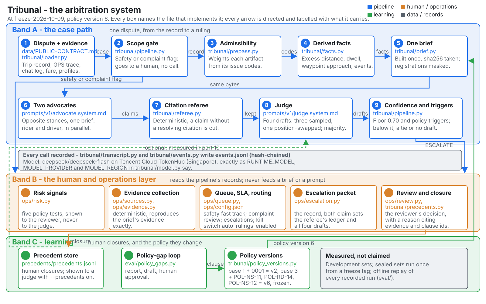

# Tribunal architecture

The diagram is the whole arbitration system as it stands at the freeze tag
`freeze-2026-10-09`, which is policy version 6, plus the post-sealed changes of
2026-10-10 and 2026-10-11, drawn as a **container view** in the C4 style: one
dispute's path down the middle, the model provider and the measurement tooling on
the left, the learning loop and the human operations on the right. Every element
names the file that implements it, and every arrow is directed and labelled with
what it carries.

**How to read it.** The legend's six swatches are the kinds of element: a blue
outline is deterministic code, purple is a call to a language model, orange is a
person or an operations step, grey is data or a record, green is the learning
loop, and a grey dashed outline is an external system. A **solid** arrow carries
every case; a **dashed** arrow or box is optional and is off at the freeze.

**How it was checked.** Nothing may sit on text. Every label was given an
estimated box -- its `x`, its `y`, its length times 0.55 times its font size for
a width, and its font size for a height -- and no `<line>`, `<path>` or
`<polygon>` segment crosses one, nor does one label's box overlap another's. The
eleven badges' own numbers are read as part of their badge, not as labels. Every
arrow down the middle of the diagram was re-drawn along the column's left edge,
beside the numbered badges, and every label that had been written on its own
arrow was moved clear of it, so the check returns nothing.

## One dispute, down the middle

**Rider or driver.** A person files a dispute. The four files it arrives as --
the trip record, the GPS trace, the chat log and the fare breakdown -- are
**files**, and they are read into one **Case record**, whose shape
`data/PUBLIC-CONTRACT.md` defines: `schema_version`, `case_no`, `dispute` and
`evidence`, with a missing artifact keeping its `evidence_id` and its `payload`
`null`.

**Evidence collection.** `ops/evidence.py` and `ops/sources.py` feed the case
record from below. `ops/sources.py` builds one index over a case root and
exposes six mocked source systems as adapters; `ops/evidence.py` is given only
the dispute and fetches the **same artifacts** the case file carries, in the
order every case file files them. It never reads `dispute.evidence_ids` to
decide what to fetch. A reader can check that both are deterministic and that
neither calls a model.

**1. Load the case.** `tribunal/loader.py` loads one case and refuses a
malformed record: a document that is not an object or is missing one of its four
top-level keys, a `case_no` that disagrees with the case that was asked for, a
`dispute` that is not an object or an `evidence` that is not an array, a manifest
entry whose `dispute_id`, `trip_id` or `category` disagrees with the file, or an
evaluation-only key anywhere in the document. A reader can check
`_check_case_shape`, `_check_manifest_agreement` and the recursive scan.

**2. Weigh the evidence.** `tribunal/prepass.py` turns an artifact's issue codes
into the weight multiplier the corpus declares: one code takes its own weight,
several take the decimal product floored at 0.25, and a blocking code is 0.0.
From policy version 3 the table is read from the loaded policy's `integrity`
block. A reader can check `weight_for` and the GPS-gap classifier.

**3. Derive facts and money.** `tribunal/facts.py` does the geometry a language
model cannot: haversine distances, the excess over the optimal route, dwell,
gaps, waypoint (ERP gantry) approach and the trip record's own pickup and
dropoff events. `tribunal/money.py` does the fare arithmetic, including the
upfront-quote remedy and the rounding rule. Neither holds a policy number --
every threshold arrives as a parameter -- and neither calls a model. A reader
can check that no clause number appears as a literal in either module.

**4. Build one brief.** `tribunal/brief.py` builds exactly one object per case,
canonicalises it and records its sha256, and both advocates read those same
bytes. From version 6 it also masks, in the free text the model reads, a
Singapore vehicle registration plate, a telephone number and an e-mail address
-- a chat message's `text`, a trip record's event details, and the dispute's two
free-text fields. Names are deliberately not masked, and versions 1 to 5 keep
their bytes exactly. A reader can check `_mask_personal_data`, `_masked_dispute`
and `VEHICLE_MASK_VERSION`, and that the module has no side or stance parameter.

**5. Scope gate.** `tribunal/pipeline.py` holds the gate, `POL-GEN-08(1)`, and
the reason code `GEN08_SCOPE`. A dispute whose `safety_flag` or `complaint_flag`
is true is never adjudicated: the record is assembled and no advocate, judge or
verifier is called. It is drawn as a diamond because it decides, and its
**flagged** branch is the blue ESCALATE line down the right side to step 11;
its **no flag** branch goes to step 6. A reader can check `scope_gate_flags`,
`scope_gate_ruling` and that the branch fires before any prompt is rendered.
Beside it, dashed, is the **integrity gate**: with `--integrity-gate` on, the
same module holds the assembled record to `POL-RD-10`'s limbs (2) and (4) -- the
trip identifiers that must all match, and the pickup and dropoff timestamps that
must not disagree -- and escalates a record that trips either, with no advocate,
judge or verifier call at all. It is off by default, it is `ROUTE_DEVIATION`
only, and its dashed arrow runs to the ESCALATE line.

**6. Two advocates.** `prompts/v1/advocate.system.md` is one template; the only
difference between the two advocates is the stance block,
`prompts/v1/stance.rider.md` or `prompts/v1/stance.driver.md`. They run in
parallel on the same brief, so the row carries a purple **LLM x2** badge. A
reader can check `check_stance_only_difference` and that the rendered prompts
differ in one region and nowhere else. Beside it, dashed, is the
**advocate-effort** switch: `--advocate-effort none` makes the two advocate
requests carry `reasoning_effort: none`, and leaves the judge's four drafts and
the verifier's request exactly as they are. It is off by default, so a run
without it sends the bytes it always sent.

**7. Citation referee.** `tribunal/referee.py` is deterministic and decides no
merits. It discards a claim whose evidence ids or clause ids do not resolve in
the loaded brief, a claim that cites an impaired artifact without naming its
issue code, and a claim grounded on a context-only profile field. A reader can
check `_check_claim` and the closed set of reason codes.

**8. Judge panel.** `prompts/v1/judge.system.md` is the prompt and
`tribunal/pipeline.py` runs the panel, so the row carries a purple **LLM x4**
badge. Four drafts are taken: three sampled at temperature 0.7 with distinct
seeds and one position-swapped draft. A reader can check `DEFAULT_JUDGE_VOTES`
and `JUDGE_VOTE_TEMPERATURE`. The row also carries a dashed note,
**optional: stop once 3 of 4 agree (--early-majority)**: with the switch on, and
only with `--parallel-calls`, the panel publishes as soon as the position-swapped
draft and two sampled drafts are back and a majority of the returned drafts agree
on all four graded fields. It is off by default, and a run without it is byte for
byte what it was. A reader can check `EARLY_MAJORITY_MIN_SAMPLED` and
`_join_calls_until`.

**9. Draft checks.** `tribunal/pipeline.py` holds the **ten** checks a draft
must pass before it can be voted on -- `DRAFT_CHECK_CODES` names them, from
`DRAFT_RULING_NOT_AN_OBJECT` to `DRAFT_BELOW_FLOOR`. A draft that fails one
abstains with that code rather than being counted. A reader can check that the
tuple holds ten codes and that every abstention in a record names one of them.

**10. Vote and floor.** `tribunal/pipeline.py` reads the floor from the policy
(0.70) and never types it as a number, and takes the majority over all four
graded fields together -- the ruling, both amounts and the referral clause
references. With four votes the threshold is `votes // 2 + 1`, which is 3, so
the question on the diamond is whether **3 of 4 agree** and the confidence is
at or above the floor. Its **no** branch is the ESCALATE line down the right
side to step 11; its **yes** branch goes to step 11 as a ruling. A reader can
check `confidence_floor`, `vote_key` and `_reduce_vote`.

**11. Publish the result.** The case ends as a ruling -- `FULL_REFUND`,
`PARTIAL_REFUND`, `NO_ACTION` or `DRIVER_COMPENSATION`, with amounts read off
the brief's published money block -- or as `ESCALATE` with its reason code.
A reader can check `REQUIRED_AMOUNTS` and the escalation reason codes.

**Run records.** The **case file** and the transcripts of every call are written
under `runs/`, one directory per set and per model. `tribunal/events.py` writes
a hash-chained event log beside them in which every line carries the previous
line's digest, and `tribunal/transcript.py` writes one entry per call with the
prompt digests and the raw response. A reader can check `verify_chain` and that
a run directory's chain verifies. The **WorkBuddy connector** reads those records
and nothing else: `integrations/workbuddy/` is a read-only MCP server that
answers a support agent's questions about a case, a queue or a packet from the
committed files, with no key and no network, and the solid arrow from Run records
is that read.

## The left column

**Model provider.** The external system the calls go to: Tencent Cloud TokenHub
in Singapore, serving `deepseek/deepseek-flash`. `tribunal/model.py` is the one
place the runtime model is named, through `RUNTIME_MODEL`, `MODEL_PROVIDER` and
`MODEL_REGION`; `tribunal/llm.py` sends the request -- JSON over HTTPS to the
provider's own endpoint; and `tribunal/transcript.py` logs the call. The purple
**call** arrows from steps 6 and 8 are the two calls the pipeline makes on every
case; the draft verifier's dashed arrow is the optional third.

**Draft verifier.** `prompts/v1/verifier.system.md` is the prompt for the pass
that reads a case's drafts once and asks whether any of them asserts something
the brief contradicts. It is dashed because it is optional: it is off at the
freeze, and with it off a draft's record carries no `verification` key at all.

**Measured, not claimed.** Everything that scores the system rather than runs
it. `eval/run_benchmark.py` is the runner; `eval/development_sets.py` is the
sets; `eval/grade.py` grades a run against a key; `eval/sealed_report.py` prints
a sealed set's figures; `eval/fairness.py` measures error lean, position-swap
agreement and calibration; `eval/baselines.py` scores the baselines; and
`eval/readiness.py` reports whether the repository is ready. The audits sit
beside them: `eval/verify_drafts.py` re-checks a run's recorded drafts,
`eval/verify_rationales.py` audits the answer key's hand-written rationales
against the package's arithmetic, `eval/amount_rule.py` re-reduces the recorded
drafts under a second reading rule, `eval/v6_runs.py` reads the version-6 batch,
`eval/func_sets.py` reads the four functional sets, `eval/early_majority.py`
replays the early-majority rule over every version-6 case and asserts the
published ruling is unchanged, `eval/integrity_gate.py` replays the
record-integrity gate over every version-6 case and reports which records it
would escalate, and `eval/advocate_effort.py` compares a run made with reasoning
off against its baseline, case by case and field by field. The **grade** arrow
comes from the run records.

**Debate viewer.** `ui/build.py` turns each run's own transcript into the two
views a person can look at -- each agent's words, in order, replayed from the
record. It is the site's **replay**, and it is published under `/replay/`. It
makes no model call: the **replay** arrow is a reading of the run records and
nothing else.

## The right side: the learning loop

The green dashed box is the loop that changes the policy, and a person approves
every change in it.

**Precedent store.** `precedents/precedents.jsonl` is an append-only,
hash-chained store of closures a human reviewer made. With `--precedents` on,
the judge is shown up to three of them that share clauses with the case; with it
off the key is absent. The dashed arrow from the store to the judge is that
optional switch. A reader can check that no amount and no summary travel in the
block.

**Policy-gap loop.** `eval/policy_gaps.py` finds the cases the policy could not
decide, groups them, and asks a model -- through
`prompts/v1/policy_drafter.system.md` -- to draft one clause for a group a
person has closed at least twice. It carries a purple **LLM** badge because that
one call is the only model it makes. A draft is a proposal until a person
approves it, and the **approved** arrow is that approval.

**Policy versions.** `tribunal/policy_versions.py` builds the policy a case is
briefed against. Base 1 is version 1 and its amendment `0001` makes version 2;
base 3 is version 3 and its three amendments -- `POL-NS-11`, `POL-RD-14` and
`POL-NS-12` -- make version 6, so **v6 = base 3 + 3 clauses**. That is the
version this diagram is drawn at and the version the freeze tag fixes, and the
**v6** arrow carries it back into step 4. A reader can check
`highest_available_version` and `owner_of_version`.

## The right side: human operations

The orange dashed box reads the records and never feeds a brief or a prompt.
Everything in it happens after the pipeline has published a result.

**Support reviewer.** A person opens a case. The **decides with** arrow is the
short step from the person to the module they decide through.

**Reviewer decides.** `ops/review.py` wraps `tribunal/precedents.py`'s `close`
with one more requirement, a `--packet-sha256` that must equal the packet
rebuilt now, and the closure carries the reviewer's reason citing this case's
own evidence and the policy's own clause ids. The **closure** arrow is that
closure reaching the precedent store.

**Evidence window (OPS-EW-01).** `ops/evidence_window.py` makes `POL-GEN-06(4)`'s
`REQUEST_EVIDENCE` executable: the reviewer opens one window to both parties,
each files a record before it closes, and the reviewer decides on what arrived.
The **request evidence** arrow is the reviewer opening it from the decision above
and **closes** is the window closing back into that decision. Its clock never
stops for missing evidence, and that is the operations rule `OPS-EW-01`, written
in `ops/config.json`, and not a clause of the frozen policy. A reader can check
`open_window`, `submit`, `status` and `close`.

**Escalation packet.** `ops/escalation.py` builds what a reviewer is handed: the
case, both advocate briefs, the admissibility report, the judge's explanation
verbatim, all four drafts and their abstentions, and the risk signals
`ops/risk.py` computes. The **packet** arrow is the reviewer picking it up. A
reader can check that no `expected` and no `matched` field reaches a packet.

**Appeal (POL-GEN-04).** `ops/appeal.py` checks an appeal against each of the
clause's six named checks -- `once`, `in_time`, `ruling_exists`, `evidence`,
`reviewer` and `execution` -- and, when the appeal is admissible, names the
reviewer who will hear it. It decides nothing about the merits: an appeal is a
route to human review, not a ruling. The **assigns** arrow is that reviewer.

**Queue, SLA and lanes.** `ops/queue.py` sorts the disputes of a run into the
safety, human-review and auto lanes, and `ops/config.json` holds the team's SLA
targets and the kill switch `auto_rulings_enabled`. A ruling whose amount is
above `POL-GEN-05`'s SGD 8.00 execution threshold is held for release and placed
in the human queue; every human-lane case carries `POL-GEN-06(2)`'s 48-hour
first-review clock beside its lane target; and a chat message that carries a
threat is fast-tracked into the safety lane ahead of every other lane, read by
`ops/chat_signals.py`. The **every case** arrow is the run records being read;
**human, safety** is a dispute going up to the packet; and out-of-scope
categories land here too. A reader can check that no threshold comes from the
policy and that the kill switch moves an auto case into human review.

**Notices and the support page.** `ui/v2/build.py` is the product view and the
site's front door: for each case the ruling, the money and POL-GEN-04's own
appeal route, built from the record with no model call, and the whole site is
hosted on Tencent EdgeOne Pages. The **auto** arrow is the queue handing a case
to it and **appealed** is an appeal coming back up to the appeal command.

## What the arrows carry

Every arrow in the diagram is labelled with what it carries, so the labels are
the contract between the boxes: `files`, `same artifacts`, `case`, `no flag`,
`flagged`, `yes`, `no`, `case file`, `call`, `verify`, `grade`, `replay`,
`approved`, `v6`, `decides with`, `request evidence`, `closes`, `packet`,
`assigns`, `human, safety`, `every case`, `auto`, `appealed` and `precedents`.
